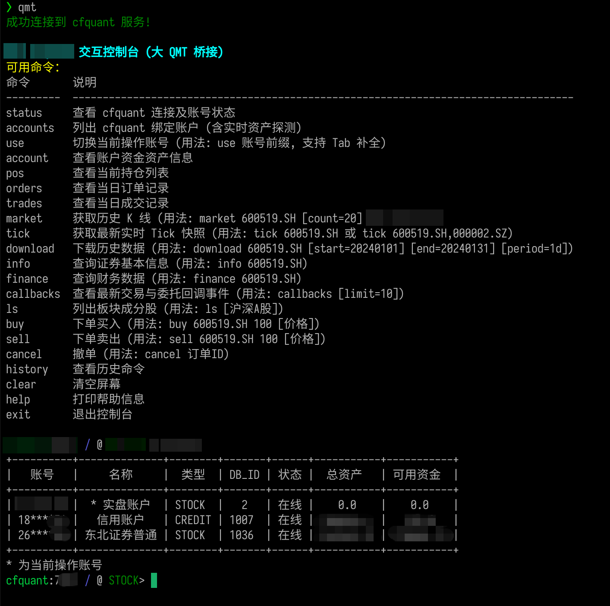

# QMT cfquant CLI (独立版)

基于 cfquant REST API 与 大QMT 交互的命令行控制台。
支持交互式命令、Tab 自动补全、账号切换、账户/持仓/订单/成交查询与下单。



## 依赖

```bash
pip install -r requirements.txt
```

## 配置

复制 `.env.example` 为 `.env` 并填写:

```bash
cp .env.example .env
```

配置文件查找顺序: 脚本所在目录的 `.env` -> `~/.qmt_cli.env`。

## 使用

```bash
python qmt_cli.py          # 交互模式
python qmt_cli.py help     # 非交互执行单条命令
```

常用命令:

| 命令 | 说明 |
| --- | --- |
| `status` / `account` | 查看连接状态 / 账户资产 |
| `accounts` | 列出绑定账户 (账号已打码) |
| `use 1234<Tab>` | 按前缀切换账号, Tab 补全 |
| `pos` / `orders` / `trades` | 持仓 / 当日委托 / 当日成交 |
| `market 600519.SH` | 历史 K 线 |
| `tick 600519.SH` | 实时五档快照 |
| `buy 600519.SH 100 [价格]` / `sell ...` | 下单 (限价传价格, 不传为市价) |
| `cancel 订单ID` | 撤单 |
| `help` / `exit` | 帮助 / 退出 |

## 文件清单

- `qmt_cli.py` — 控制台入口 (单文件)
- `cfquant_client.py` — cfquant HTTP API 客户端
- `.env.example` — 配置样例
